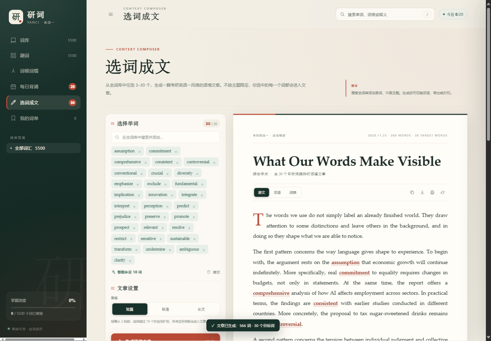
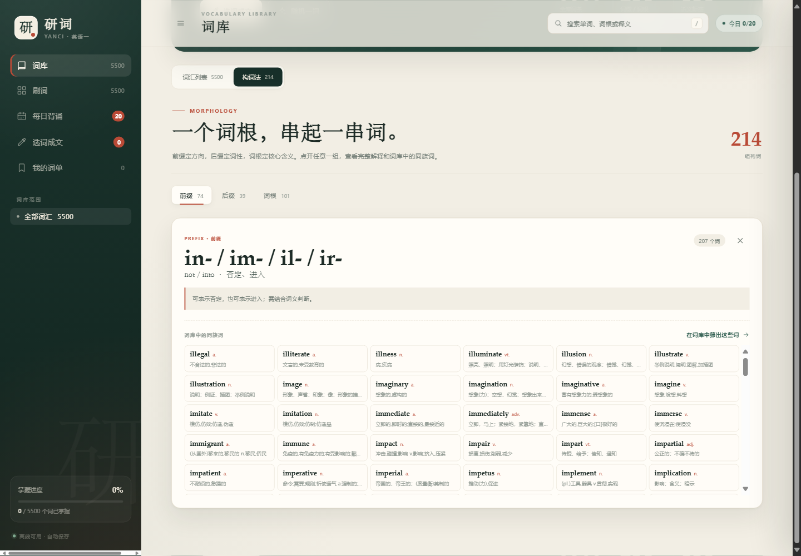
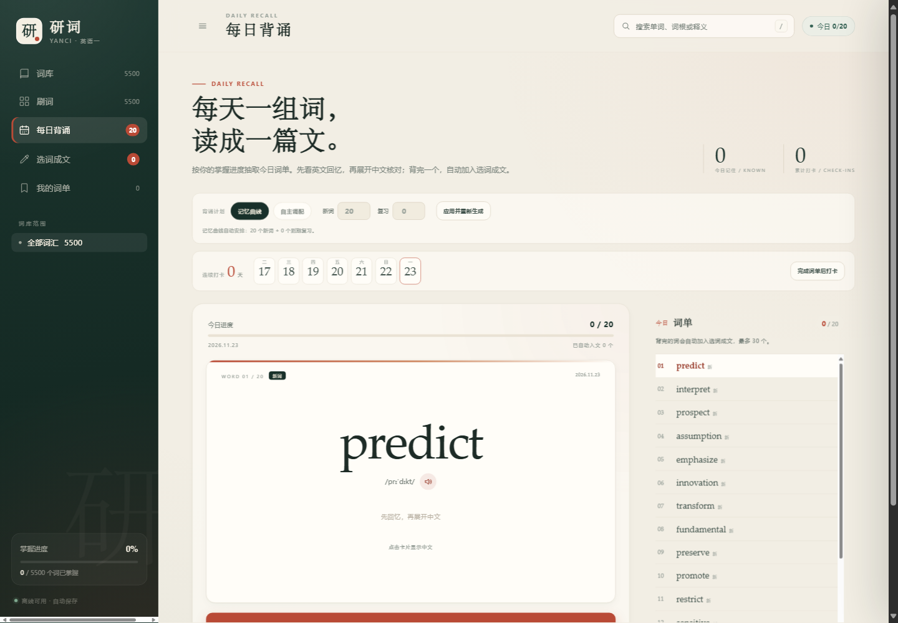
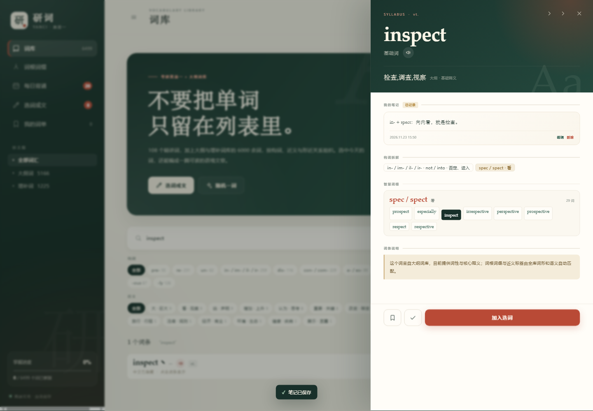
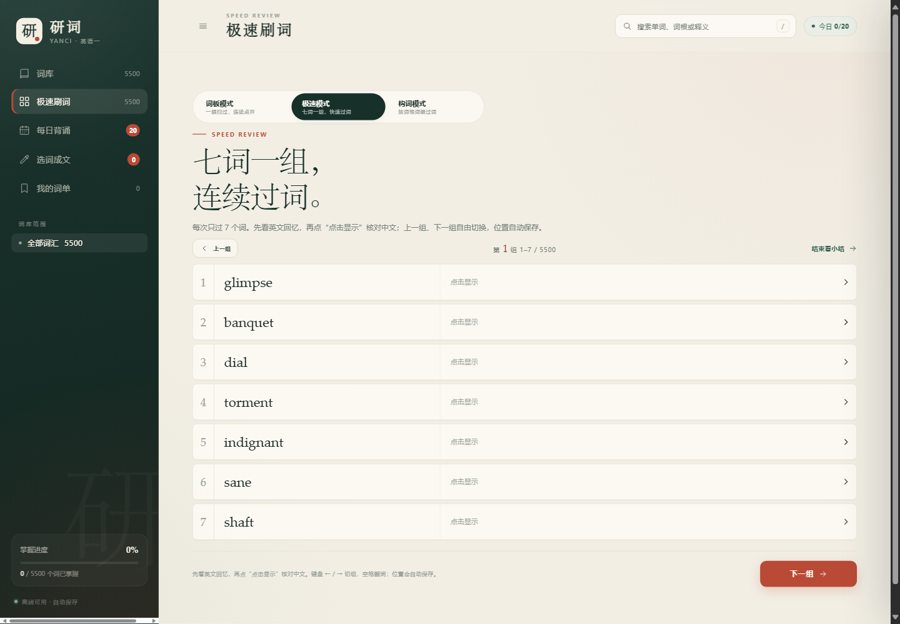
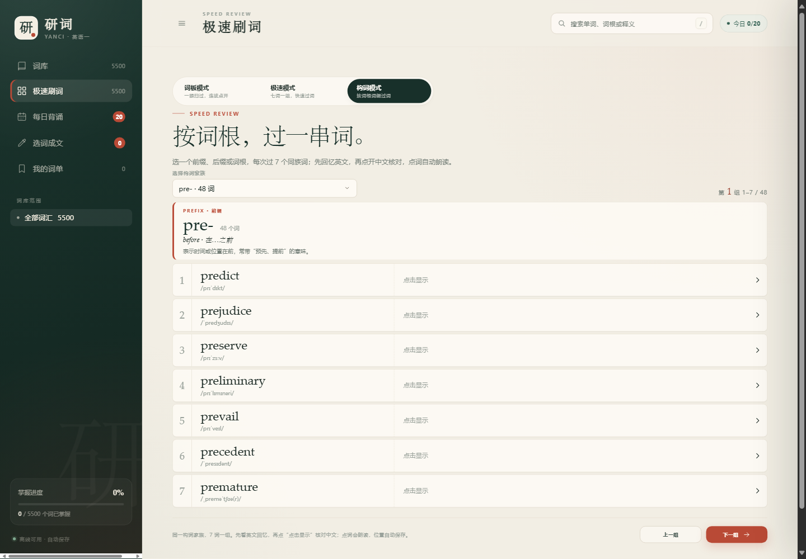
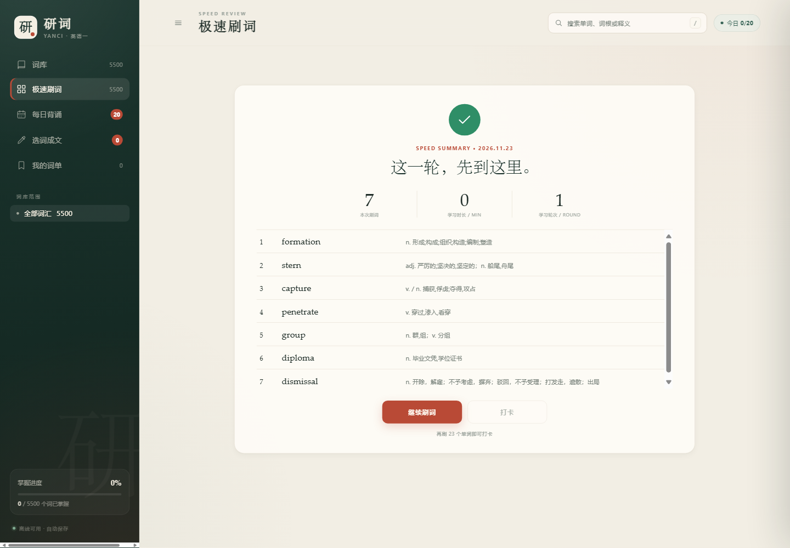
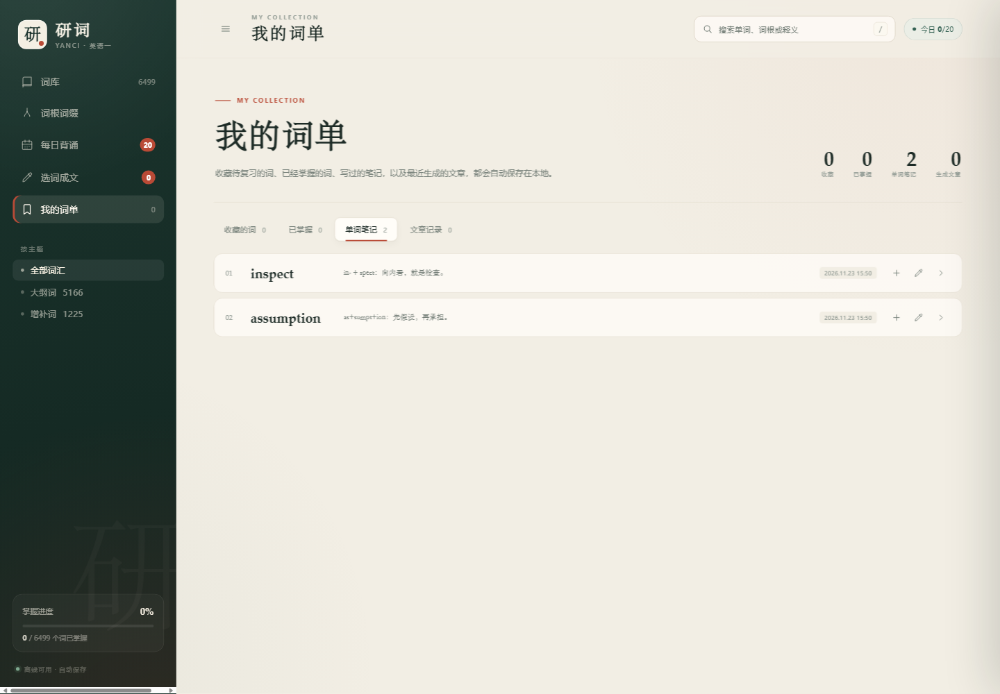

# 研词 YANCI · 考研英语一词汇工坊

一个不需要安装、不需要构建的网页 App：把考研英语一的大纲词汇整理成可按构词、近义、形近关系阅读的词库，并把 3–30 个选中的单词编成可阅读的语境文章。总纲词库一次展示全部单词，只保留英文、音标、词性、中文释义；中文默认隐藏，点词条展开、再点收回，音标旁可直接朗读。

## 预览




















## 打开方式

### 方式一：直接打开

双击 `index.html`，用 Chrome / Edge / Firefox 打开即可。所有功能都在本地运行，不依赖网络。

### 方式二：本地服务器（推荐）

在项目目录执行：

```bash
python -m http.server 8765
```

然后访问：

```text
http://127.0.0.1:8765/
```

> 直接双击打开时，个别浏览器会限制剪贴板 API；App 已内置 `execCommand('copy')` 兜底。

### 方式三：局域网共享

双击项目根目录的 `start-lan.bat`，保持窗口打开，然后在命令提示符执行 `ipconfig`，找到本机 WLAN 的 IPv4 地址。同一 Wi-Fi 下的手机或电脑访问：

```text
http://你的局域网IP:8765/
```

Windows 防火墙需要允许 Python 的入站访问；如果其他设备打不开，检查是否在同一 Wi-Fi，以及路由器是否开启了“AP 隔离”。

### 方式四：临时公网地址

双击项目根目录的 `start-public.bat`，保持窗口打开。脚本会先确认本地服务在运行，然后通过 `tools/bore.exe` 在 bore.pub 上开一个临时公网端口。

窗口里会显示类似：

```text
listening at bore.pub:21616
```

在手机浏览器打开：

```text
http://bore.pub:21616/
```

把端口换成窗口里实际显示的数字。手机用流量、或者在外地也可以打开。注意：

- 电脑和这个窗口必须一直开着，关闭窗口后地址立即失效；
- 地址是临时的，每次重新运行端口都会变化；
- 这是 HTTP 地址，不是 HTTPS；
- 拿到地址的人都可以访问，不要当作私密站点；
- 如果要长期稳定、电脑关机也能访问，请把整个 `kaoyan-english` 文件夹部署到 Cloudflare Pages、Netlify 或 Vercel 这类静态托管。

## 功能

- **总纲词库**：5500 个词一次全部展示，其中 108 个精讲词、5166 个大纲基础词、226 个优先补充词；每一行只保留英文、音标、中文释义（释义前带 `n. / v. / adj. / adv. / prep.` 等词性），支持全库搜索（含笔记内容）、收藏、已掌握、近义、排序。中文默认隐藏，点词条展开、再点收回。
- **构词法（就在词库内）**：词库页顶部切换“词汇列表 / 构词法”，无需再跳独立页面；构词法按前缀、后缀、词根三类展示，点任意一组会展开完整解释和词库同族词，并可一键筛回词库。
- **点词朗读**：点击词条本身会直接朗读单词，再点一下展开/收起中文；音标旁的喇叭按钮也能单独朗读。每日背诵卡片、极速刷词的词板、极速列表和构词列表同样支持点词发声。
- **每日背诵**：新词与复习数量可以自己设定；也可切换“记忆曲线”，按 1 / 2 / 4 / 7 / 15 / 30 天的间隔自动安排到期复习。先看英文回忆，点卡片展开中文；标记“记住了”或“还要复习”都算完成，并自动加入选词成文（上限 30）。完成词单后可打卡，连续打卡和累计打卡保存在本地。
- **极速刷词**：三种方式。词板模式把 5500 个词压缩成密集词板，不翻页，点一个看一个并自动朗读；极速模式每次 7 个词，左侧英文、点击词条显示中文并朗读，可切上一组 / 下一组，并在结束时查看本次词数、学习时长、轮次和词表，本次累计满 30 个词即可打卡；构词模式从 214 组前缀 / 后缀 / 词根中选择一个家族，每次 7 个同族词，点词朗读并展开中文，另带家族释义和组内进度。极速与构词模式均支持键盘 ← / → 切组、空格翻词。
- **构词拆解**：前缀、后缀、词根拆分，配词根记忆与例词（精讲词）。
- **同义辨析与形近词**：精讲词提供同义词差异说明和形近词提醒。
- **近义标签**：114 个语义簇（大 / 小、增加 / 减少、聪明 / 愚蠢、旅行、法律、经济、环境、健康等），全部成员都来自当前 5500 词库；点击标签即可筛出同组词。
- **单词笔记**：在单词详情或每日背诵卡片里写辨析、搭配、例句或自己的记忆线索，两处共用同一条笔记；最多 1200 字，支持 `Ctrl / ⌘ + Enter` 保存、`Esc` 取消。笔记会单独保存，并可从“我的词单 → 单词笔记”集中查看、编辑、删除；搜索框也能直接搜到笔记内容。
- **词卡详情**：音标、朗读、英文释义、构词、词根、例句、翻译、常见搭配、同义辨析、形近词跳转、近义同组词；顶部可切换上一个 / 下一个词，词根词条会列出同根词。
- **构词数据**：库存 254 组；在当前 5500 词中实际匹配到词的 214 组会展示（74 个前缀、39 个后缀、101 个词根）。点 `pre-`、`sym-`、`suc-` 等任意卡片，展开大卡片解释和同族词，再一键筛出这些词。
- **选词成文**：
  - 文章里的每个词都可以点击：自动朗读，并弹出该词的小词卡；不只有标红的目标词。
  - 每句末尾有一个小「译」按钮，点它显示该句中文；文章顶部的“双语”仍可查看整篇对照。
  - 单词详情里的英文例句也可以点词，直接跳到那个词的详情并朗读。
  - 从全词库搜索添加，或直接在词条右侧点“＋”加入；最少 3 个，最多 30 个；
  - “智能补足 10 词”从全词库按考频补足，不按主题偏置；
  - 选词不受主题限制；词库只保留“全部词汇”，不再提供社会 / 科技 / 教育或大纲 / 增补切换；
  - 文章统一使用综合学术风格，不再需要手动选择主题；
  - 短篇 / 标准 / 长文三种结构；目标词多时自动增加段落，所有选词都会进入文章；
  - 生成原文、双语、目标词表三种阅读模式；
  - **点词查词**：点击正文里的目标词，弹出释义、构词、近义标签，可直接加入选词或打开详情；
  - **点句翻译**：点击任意英文句子，在该段下方展开对应中文，再点收起；
  - 复制、下载 TXT、打印 / 存为 PDF。
- **我的词单**：收藏、已掌握、单词笔记、最近文章记录，刷新后自动恢复。
- **移动端**：侧栏抽屉、单词详情全屏抽屉、选词成文单列布局、总纲词条自动换行。

## 目录

```text
kaoyan-english/
├─ index.html              # 页面结构与图标 sprite
├─ assets/
│  ├─ styles.css           # 视觉、响应式、打印样式
│  ├─ data.js              # 108 个精讲词、词根词缀、主题数据
│  ├─ data-syllabus.js     # 5166 个大纲基础词（word, pos, meaning）
│  ├─ data-supplement.js   # 226 个优先补充词（word, pos, meaning, phonetic）
│  ├─ data-morph.js        # 基础词根词缀清单
│  ├─ data-morph-extra.js  # 用户前缀表解析出的新增前缀
│  ├─ data-semantic.js     # 基础近义语义簇
│  ├─ data-semantic-extra.js # 扩充近义语义簇
│  └─ app.js               # 状态、筛选、详情、刷词、组稿、持久化
├─ tools/
│  ├─ validate-data.js     # 全量词库 + 构词 + 语义数据检查
│  ├─ extract-syllabus.py  # 从 PDF 抽取大纲词（开发期，需要原 PDF）
│  ├─ parse-syllabus.py    # 清洗抽取文本并生成 data-syllabus.js
│  ├─ cdp.js               # 可选的本地浏览器 QA 脚本
│  └─ source/              # PDF / 新词表抽取解析中间文件
└─ README.md
```

## 数据说明

`assets/data.js` 暴露 `window.YANCI_DATA`：

```js
window.YANCI_DATA = {
  meta:    { total, affixCount, synonymCount },
  themes:  { society, technology, education, environment, culture, self },
  affixes: [ /* prefix / suffix */ ],
  roots:   [ /* 高频词根 */ ],
  words:   [ /* 108 个精讲词条 */ ]
};
```

精讲词的主要字段：

```js
{
  id, word, phonetic, pos, meaning, en,
  freq, level, theme,
  affixIds: [],
  root: { id, label, meaning },
  morph: [{ text, type, gloss }],
  rootNote,
  example, exampleZh,
  collocations: [],
  synonyms: [{ word, note }],
  confusables: [{ word, note }]
}
```

`assets/data-syllabus.js` 暴露 `window.YANCI_SYLLABUS`，是 5166 条三元组：

```js
["abandon", "vt.", "离弃，丢弃；遗弃，抛弃；放弃"]
```

应用启动时会把每条大纲词转成基础词条，ID 为 `syl-` + 小写词形；缺少音标、英文释义、例句、同义、形近、词根等富字段，界面会隐藏空白区块，组稿时会用词性与释义生成通用语境句。

`assets/data-supplement.js` 暴露 `window.YANCI_SUPPLEMENT`，是 226 条优先补充词：

```js
["data", "n.", "数据，资料；（储存在计算机中的）数据资料", "ˈdeɪtə; ˈdætə"]
```

这些词来自《2026考研英语一词汇背诵宝典》中当前大纲词库尚未覆盖的词，按原词表的优先顺序取前 226 个，使总数达到 5500；ID 为 `sup-` + 小写词形，界面仍归在“大纲词汇”下，不单独增加分类。

界面展示释义时统一调用 `meaningWithPos(w)`：把 `pos` 加到中文释义前，并拆分释义内部夹带的 `vi. / vt. / n.` 等标记，例如 `n. 妥协，折衷；vi. 妥协；vt. 危及，放弃(原则等)`。因此词卡、详情、每日背诵、搜索建议、文章词表、TXT 导出和笔记列表看到的词性口径一致。

`assets/data-morph.js` 暴露 `window.YANCI_MORPH = { prefixes, suffixes, roots }`，每条形如：

```js
["pre", "pre-", ["pre"], "before", "表示时间或位置在前"]
```

应用会扫描全部 5500 个词形，展示在当前词库中至少命中 1 个词的组；因此不同数据版本下的前缀 / 后缀 / 词根数量会自动变化。`MORPH_EXCLUDE` 会排除明显不属于该词缀的高频误匹配词。

`assets/data-semantic.js` 暴露 `window.YANCI_SEMANTIC`，每簇形如：

```js
{ id: "big", label: "大 · 巨大", note: "尺寸、数量或程度很大", members: ["big", "large", "huge", "vast"] }
```

### 添加单词

**精讲词**：在 `data.js` 的 `words` 数组追加完整词条。`id` 必须唯一；`theme` 必须是六个主题之一；`affixIds` 必须在 `affixes` 中存在；`example` 中必须出现目标词本身。

**大纲基础词**：在 `data-syllabus.js` 的数组追加 `[word, pos, meaning]`，或重新运行解析脚本。`word` 不应与精讲词重复。

添加后运行：

```bash
node tools/validate-data.js
```

## 文章是怎么生成的

文章不是调用大模型，而是本地模板化组稿：

1. 把你选中的全部词放入文章，不做主题筛选；
2. 按文章主题与考频调整顺序（只影响阅读顺序，不删除任何选词）；
3. 每段最多 5 句，根据选词数量自动增加段落；
4. 使用主题包里的开头、过渡句、结尾；
5. 精讲词使用自己的英文例句；大纲 / 补充基础词按词性生成通用语境句；
6. 用 `wordForms()` 处理词形变化，统计每个目标词在文章中的出现次数与覆盖率；
7. 生成原文、双语、词表三种视图；
8. 文章段落同时保存英文句子与对应中文，支持点句展开翻译。

因此它离线可用、结果稳定；但文章的深度和衔接仍然受词条例句质量限制。如果要更自然的文章，可以优先扩充精讲词的 `example` / `exampleZh`，或在 `app.js` 的 `PACKS` 中增加主题开头与结尾。

## 本地数据

学习状态保存在浏览器 `localStorage`：

```text
yanci.study.v1
```

包含收藏、已掌握时间、单词笔记 `notes`、当前选词、文章、最近 8 篇文章、布局、篇幅，每日背诵计划 `daily`、计划设置 `dailySettings`、记忆曲线进度 `dailyMemory`、打卡记录 `dailyLog`，以及极速刷词进度 `sprintFast`、刷词打卡 `sprintLog`、构词刷词进度 `sprintMorph` 和当前刷词模式 `sprintMode`。清除浏览器站点数据会同时清空这些记录。

## 验证

```bash
node tools/validate-data.js
node --check assets/data.js
node --check assets/data-syllabus.js
node --check assets/data-supplement.js
node --check assets/data-morph.js
node --check assets/data-morph-extra.js
node --check assets/data-semantic.js
node --check assets/data-semantic-extra.js
node --check assets/app.js
```

当前数据校验结果：108 个精讲词 + 5166 个大纲词 + 226 个补充词，共 5500 词；254 组构词库存（214 组在当前词库中实际有匹配词）、114 个有效近义语义簇，`errors: []`。部分精选词根关联词少，属于数据覆盖提示，不是错误。

`tools/cdp.js` 是开发期 QA 脚本，需要先以远程调试端口启动 Edge / Chrome，再用它做截图与 DOM 检查。普通使用者不需要运行。

## 说明

- 大纲基础词目前只有词性与中文释义，没有例句、同义辨析等精讲内容；界面会为它们生成通用语境句，并在释义前统一补上词性。
- 组稿是模板拼接，不是 AI 写作；它保证选词覆盖率与离线可用，但不会替代真正的阅读和写作训练。
- PDF 抽取脚本依赖 Windows 自带的 SimSun 字体和原 PDF，仅用于重新生成词库，普通使用不需要运行。
